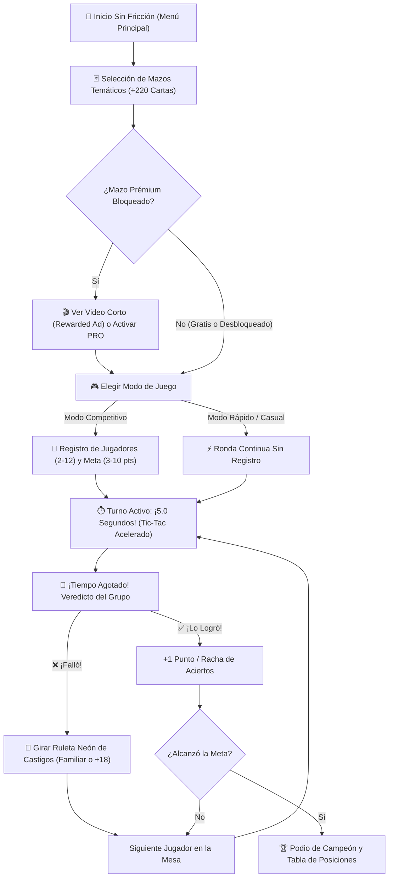

# ⚡ Reto 5 Segundos — Party Game (Flutter)

[](https://github.com/Carlos-Mayta18/5-segundos-App/actions/workflows/flutter_ci.yml)


[](LICENSE)

**Reto 5 Segundos** es un juego social dinámico, presencial y de respuesta rápida diseñado para reuniones de amigos o familia. Convierte un solo smartphone en el animador de la mesa, desafiando a los participantes a mencionar **3 cosas en menos de 5 segundos** bajo intensa presión auditiva y visual.

---

## 🎯 Propuesta de Valor y Experiencia de Usuario

- **📱 Un solo dispositivo en la mesa:** No requiere que todos los invitados descarguen la app ni que tengan conexión a internet. Se juega pasando el teléfono de mano en mano o dejándolo al centro.
- **⏱️ Presión sensorial (5.0 segundos):** Cuenta regresiva con síntesis de sonido en tiempo real (*tic-tac* que acelera su frecuencia conforme se agota el tiempo), vibración háptica y barra de progreso que muta de color (*Cian → Amarillo → Naranja → Rojo Peligro*).
- **🔔 Veredicto democrático del grupo:** Al sonar la campana de fin de tiempo, el grupo decide si el jugador logró decir las 3 respuestas válidas a tiempo (`+1 punto`) o si falló.
- **🎡 Ruleta Neón de Castigos / Retos:** Cuando alguien falla los 5 segundos, gira la ruleta interactiva de 8 categorías con más de **60 retos** configurables en modo **🎭 Sano / Familiar** o **🍻 Fiesta / Tragos (+18)**.
- **🔀 Barajado continuo sin repetición:** Algoritmo *Fisher-Yates* (`ContinuousDeckShuffler`) que garantiza que ninguna carta se repita durante toda la sesión hasta agotar el 100% del repertorio activo.

---

## 🔄 Flujo de Juego y Dinámica (Diagrama)



---

## 🃏 Modos de Juego y Mazos Temáticos (+220 Cartas)

### Modos de Partida
1. **🏆 Modo Competitivo (Por puntos):**
   - Registro de **2 a 12 jugadores** con colores neón identificadores.
   - Selección de meta de victoria (**3, 5, 7 o 10 puntos**).
   - Marcador en vivo, indicador de racha de aciertos (`🔥 Racha`) y pantalla de **Podio / Campeón** con opción de revancha inmediata.
2. **⚡ Modo Rápido / Casual (Sin fin):**
   - Cero configuración: entra directo a jugar sin registrar nombres ni puntajes. Ideal para romper el hielo o dinámicas de castigos.

### Catálogo Inicial de Mazos
| Mazo | Enfoque | Cartas | Acceso |
| :--- | :--- | :---: | :---: |
| **👨‍👩‍👧‍👦 Clásico / Familiar** | Cultura general, comida, colegio y situaciones cotidianas aptas para todo público. | `55` | Gratis |
| **🎮 Geek / Cultura Pop** | Cine, videojuegos, anime, series, superhéroes, memes e internet. | `55` | Gratis |
| **🍻 Noche de Copas / Fiesta** | Anécdotas nocturnas, tragos, fiestas, resacas y salidas entre amigos adultos. | `55` | Video Recompensado / PRO |
| **🔥 Picante / Confesiones (+18)** | Preguntas sugerentes, citas, ex-parejas y temas sin filtro para grupos de confianza. | `55` | Video Recompensado / PRO |

---

## 🏗️ Arquitectura del Proyecto

El proyecto sigue una arquitectura limpia, modular y **100% Offline-First**:

```text
lib/
├── main.dart                          # Punto de entrada no bloqueante y configuración de orientación
├── theme/
│   └── app_theme.dart                 # Sistema de diseño Neón / Fiesta Nocturna (colores, sombras, gradientes)
├── models/
│   ├── deck_model.dart                # Modelos de mazos (GameDeck) y cartas (DeckQuestion)
│   └── game_session.dart              # Jugadores, modos de juego y motor ContinuousDeckShuffler
├── data/
│   ├── decks_data.dart                # Repositorio offline con las 220 consignas en 4 mazos
│   └── punishments_data.dart          # Repositorio de +60 retos para la Ruleta (Familiar y Fiesta +18)
├── services/
│   ├── sound_service.dart             # Sintetizador PCM (.wav) en memoria RAM + Haptics (tic-tac y campana)
│   └── monetization_service.dart      # Gestión de AdMob (Banner/Interstitial/Rewarded) y Google Play Billing
├── widgets/
│   └── punishment_wheel_dialog.dart   # Ruleta animada con CustomPainter, física de giro y selector de modo
└── screens/
    ├── home_screen.dart               # Menú principal sin fricción, selector multimazo y desbloqueo PRO
    ├── player_setup_screen.dart       # Configuración de jugadores, meta de puntos y modalidad de castigos
    ├── gameplay_screen.dart           # Tablero activo de 5 segundos, modo carta oculta y votación grupal
    └── victory_screen.dart            # Podio final, tabla de posiciones y revancha rápida
```

---

## 💰 Modelo de Monetización (No Intrusivo)

- **Banners discretos:** Solo visibles en pantallas de menú o configuración; **nunca** durante el turno activo de 5 segundos.
- **Rewarded Ads (Videos con recompensa):** Permiten desbloquear mazos prémium (*Noche de Copas* y *Picante*) gratis durante la sesión.
- **Versión PRO (Compra única de por vida):** Elimina toda la publicidad de forma permanente y desbloquea todos los mazos temáticos (`SharedPreferences` + Google Play Billing).
- Los IDs de prueba oficiales de Google AdMob y el SKU de Google Play Console están centralizados en [`lib/services/monetization_service.dart`](lib/services/monetization_service.dart).

---

## 🚀 Instalación y Ejecución Local

### 1. Clonar el repositorio
```bash
git clone https://github.com/Carlos-Mayta18/5-segundos-App.git
cd 5-segundos-App
```

### 2. Instalar dependencias
```bash
flutter pub get
```

### 3. Ejecutar la aplicación
- **En navegador (Chrome / Edge):**
  ```bash
  flutter run -d chrome
  ```
  *(En Windows también puedes hacer doble clic o ejecutar `.\ejecutar.bat` desde la terminal).*

- **En dispositivo o emulador Android:**
  ```bash
  flutter run
  ```

### 4. Ejecutar pruebas automatizadas y análisis de código
```bash
flutter analyze
flutter test
```

---

## 📦 Compilación para Google Play Store (`.aab` / `.apk`)

Para generar el paquete de lanzamiento listo para subir a **Google Play Console**:

```bash
# Generar Android App Bundle (.aab) para Google Play Store
flutter build appbundle --release

# Generar APK instalable directo
flutter build apk --release
```

---

## 📄 Documentación Legal y Versiones

- **[Política de Privacidad (Google Play Store)](PRIVACY_POLICY.md)**
- **[Historial de Versiones (Changelog)](CHANGELOG.md)**
- **[Licencia MIT](LICENSE)**

---

## 👤 Autor

Desarrollado por **Carlos Mayta** ([`@Carlos-Mayta18`](https://github.com/Carlos-Mayta18)).
